# Grok Botとdotsの違いは？料金・できることの比較と、ククルFMの使い分け

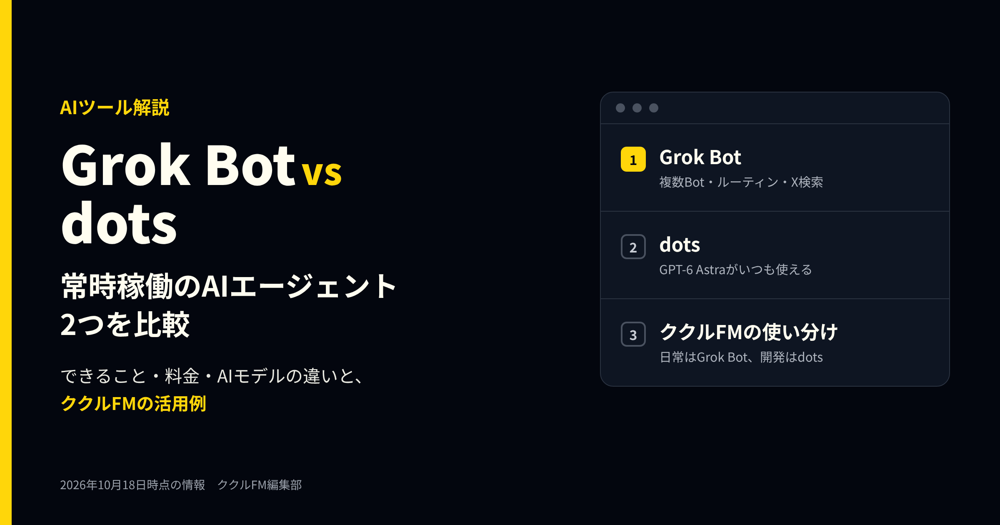

**公開日**: 2026.10.18  
**カテゴリ**: AIツール  
**著者**: ククルFM編集部  
**概要**: SpaceXAIのGrok Botと、OpenAIのdotsは、どちらも自分専用のパソコンで仕事を進める常時稼働のAIエージェントです。できること・料金・使うAIモデルの違いを表で比べ、日常の作業はGrok Bot、開発はdotsと使い分けるククルFMの活用例を紹介します。

---

2026年の夏から秋にかけて、「話しかけると、自分専用のパソコンで仕事を最後まで進めるAI」が相次いで登場しました。代表的なのが、SpaceXAI（旧xAI）の「Grok Bot（グロック・ボット）」と、OpenAIの「dots（ドッツ）」です。

どちらも、チャットで頼むと、AIがクラウド上のパソコンとブラウザを使い、アプリにログインして作業を進めます。人が見ていない間も動き続ける点も同じです。一方で、使うAIモデル、得意なこと、料金、承認の仕組みには違いがあります。

ククルFMでは、2つを役割で分けて使っています。この記事では、2つの違いを表で整理し、当社の活用例を紹介します。情報は2026年10月18日時点です。どちらも発表から日が浅く、内容が週単位で変わっているため、使う前に公式の情報も確認してください。

※本記事はAI（Claude）の支援を受けて作成し、内容は編集部が各社の公式情報と照らし合わせて確認しています。

## 先に結論：日常の作業はGrok Bot、開発はdots

- **Grok Bot**：Botごとに役割を決め、決まった時刻やきっかけで動かす「ルーティン」が得意。情報の定期チェックや、メールで届く予定の反映のような、日々の細かい作業を任せられる
- **dots**：OpenAIの最上位モデル「GPT-6 Astra」で動き、1つの画面でいくつもの仕事を文脈ごとに使い分けてくれる（マルチタスク）。開発の段取りのように、話があちこちに広がる仕事に向く
- **ククルFMは併用**：日常の作業はGrok Bot、開発のサポートはdotsと、役割を分けて使っています

## Grok Botとdotsとは：自分のパソコンを持つ「常時稼働のAIエージェント」

これまでのAIは、聞かれたことに答えるのが中心でした。Grok Botとdotsは、仕事を渡すと、AIが自分で手順を考えて最後まで進めます。

- **Grok Bot**：SpaceXAIとCursorが提供しています。2026年8月11日にベータ版（試験提供）として公開されました。パソコン用のアプリ（Mac・Windows・Linux）とiPhoneのアプリから使います
- **dots**：OpenAIが2026年9月29日に発表しました。ChatGPTのパソコン用アプリ・Web・スマホアプリから使い、SlackやTeamsからも話しかけられます

2つとも、AIがクラウド上に専用のパソコンとブラウザを持ちます。人のパソコンとは切り離された場所で作業するため、作業中も自分のパソコンは普段どおり使えます。

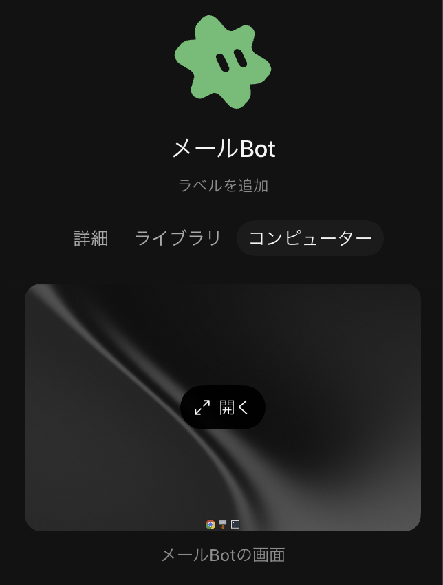
*Grok BotのBotごとに用意されるパソコン。「開く」で作業の様子を見られる（当社の画面、2026年10月撮影）*

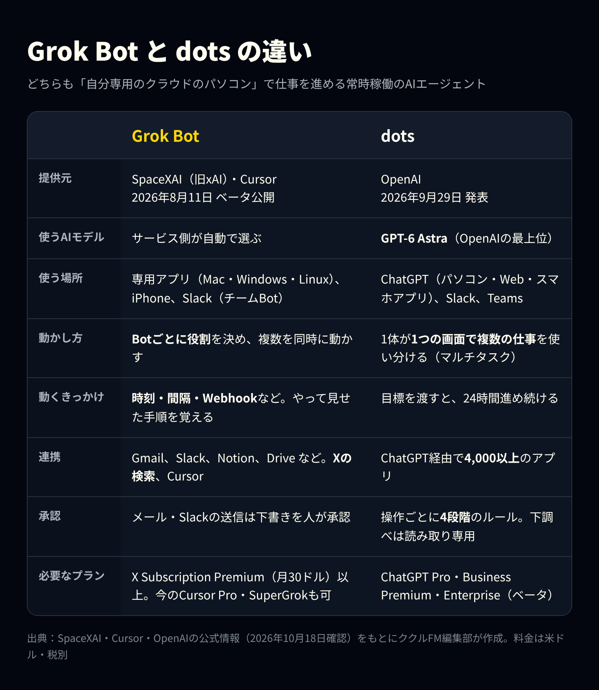
*Grok Botとdotsの比較（各社の公式情報をもとに編集部作成、2026年10月18日時点）*

## Grok Botの特徴

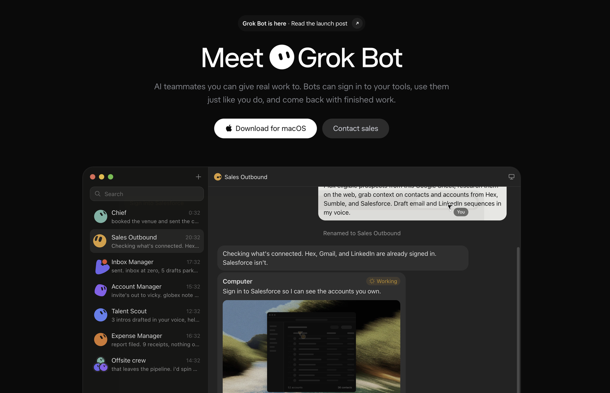
*Grok Botの公式ページ（出典：SpaceXAI「Grok Bot」、2026年10月18日撮影）*

### 1. 決まった時刻やきっかけで動く「ルーティン」

作業の手順を一度見せると、Botがそれを覚えて「ルーティン」として保存します。ルーティンは、毎日・毎時・一定の間隔といった時刻のほか、Webhook（ほかのシステムからの合図）をきっかけに動かせます。結果を誰に届けるかも、ルーティンごとに決められます。

### 2. 複数のBotを並べて動かせる

最初から複数のBotを作り、同時に動かせます。全体を見る「まとめ役」のBotが、専門のBotに仕事を振り分ける使い方も公式に紹介されています。作ったBotは「チームBot」として社内に公開し、Slackから呼び出すこともできます。

### 3. Xの投稿や、いつものアプリを調べられる

10月上旬から、Xのアカウントを接続しなくても、Xの投稿やプロフィールを検索して読めるようになりました。連携できるアプリには、Gmail、Outlook、Slack、Notion、Google Drive、OneDrive、Canva、会計ソフトのQuickBooksなどがあります。10月11日には、Bot専用のメールアドレスや、X MoneyとStripe Linkでの支払いの機能も加わりました。

### 4. 使うAIモデルはサービス側が選ぶ

Grok Botでは、作業に使うAIモデルをサービス側が自動で選びます。モデルを選ぶ画面はなく、利用者が指定することはできません。

## dotsの特徴

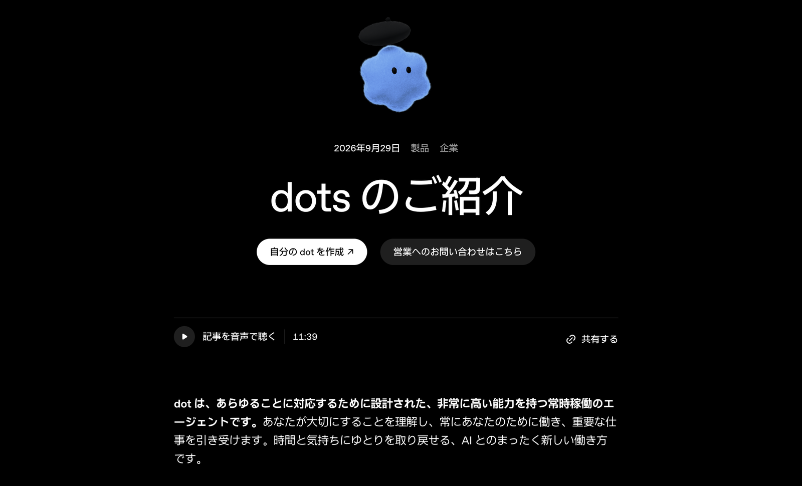
*dotsの紹介ページ（出典：OpenAI「dots のご紹介」、2026年10月18日撮影）*

### 1. GPT-6 Astraがいつも使える

dotsは、OpenAIの最上位モデル「GPT-6 Astra」で動きます。ChatGPTの通常のチャットでAstraを使うには、Proなどの上位プランでも回数に上限があります。一方、dotsとの会話はChatGPTの利用上限に数えられません。考える力が要る仕事を、いつも最上位のモデルに任せられるのが、dotsの一番の利点です。

### 2. つなげられるアプリが4,000以上

ChatGPTのプラグインを通じて、4,000以上のアプリとつながります。ChatGPTの「メモリー」（覚えている情報）も引き継ぐため、普段からChatGPTを使っている人ほど、説明の手間が少なくて済みます。手元のパソコンを使わせることもできます（初期状態ではオフ）。

### 3. 承認のルールを4段階で決められる

AIにどこまで任せるかを、操作ごとに4段階で決められます。

| 設定 | 動き |
|---|---|
| 質問せずに実行 | AIの判断で進める |
| 事前に頼んだときだけ実行 | 指示の中で頼んだ操作だけ進める |
| 実行の前に確認 | 毎回、人の承認を待つ |
| 人に渡す | AIは実行せず、人に引き継ぐ |

AIが自分から行う下調べは「読み取り専用」で、メッセージを送ったり、アプリの内容を書き換えたりはしません。パスワードの変更などの重要な操作は、常に人が行う仕組みです。今使えるのは自分専用の「最初のdot」1体で、複数のdotを組み合わせる形は今後の予定とされています。

## 料金と使えるプラン（2026年10月18日時点）

| 項目 | Grok Bot | dots |
|---|---|---|
| 新しく申し込む場合 | The X SubscriptionのPremium（月30ドル）以上 | ChatGPT Pro（月100ドルから。どの料金帯が対象かは公式ヘルプに明記なし）、Business Premium |
| 含まれないプラン | Free、Plus（月8ドル） | 無料、Plus |
| 会社向け | チーム用のシート（Premium以上と同じ1人あたりの料金）、Enterprise | Enterprise（ベータ。管理者が有効にする） |
| 利用枠 | 週ごとにリセットされる専用の枠 | 最初の1体はプランに含まれる。dotsとの会話はChatGPTの利用上限に数えない |
| 日本での利用 | 利用できる。アプリの表示を日本語にできる | Proは日本も対象（欧州経済領域・スイス・英国は対象外） |

※料金は米ドル・税別。

SpaceXAIは10月12日に、Grok、Cursor、Xの有料プランをまとめた「The X Subscription」を始めました。Premium（月30ドル）には、Grok（SuperGrok）、Cursor Pro、X Premium+に相当する内容が含まれます。今のCursor ProやSuperGrokの契約は、そのまま続けられ、それらのプランでもGrok Botを使えます。

dotsは、ChatGPTのProかBusiness Premiumが必要です。ChatGPTの月3,000円のPlusでは使えません。両方を使うと、月に合わせて130ドル以上かかる計算です。併用するなら、それぞれに任せる仕事をはっきり分けることをおすすめします。

## ククルFMの活用例

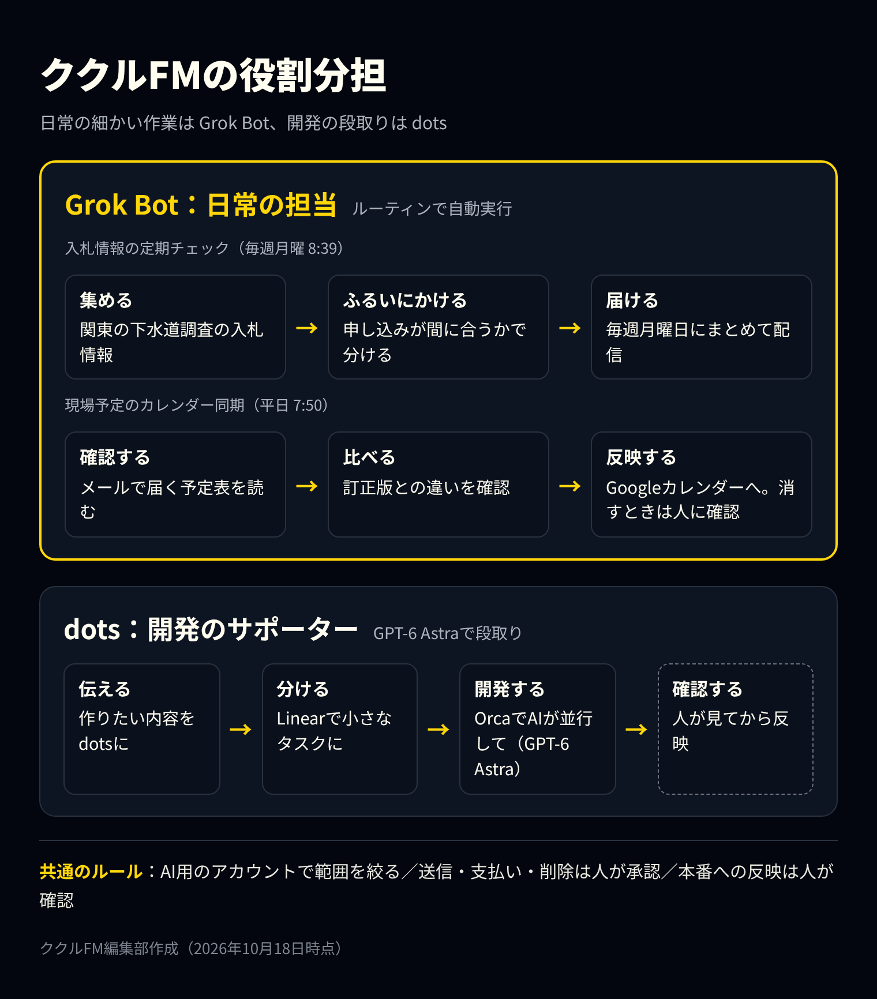
*ククルFMでのGrok Botとdotsの役割分担（編集部作成）*

### Grok Bot：日常の「痒いところに手が届く」担当

Grok Botには、毎日・毎週くり返す細かい作業を、用途ごとにBotを分けて任せています。

**入札情報の定期チェック（毎週月曜 8:39）**

「下水道案件チェッカー関東」というBotが、関東の自治体が出す下水道調査の入札情報を集め、毎週月曜の朝にまとめて届けます。「申し込みが間に合う一般競争」「参考の指名競争」「締切が近い設計・清掃」のように分けてくれるので、週の初めに読むだけで、その週に動くべき案件が分かります。参加の条件や締切が確認できないものは「公告本文を見てください」と、人が確かめるべき点も添えてくれます。

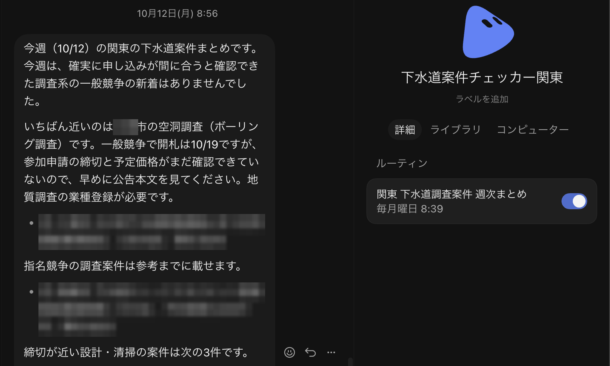
*毎週月曜に届く入札情報のまとめと、ルーティンの設定（当社の画面。案件名・自治体名は加工しています）*

**現場予定のカレンダー同期（平日 7:50）**

「下水道日程Bot」は、取引先からメールで届く現場の予定表を平日の朝に確認し、社内のGoogleカレンダーに反映します。予定表の訂正版が届いたときは、前の版との違いを確かめて報告します。取り消しになった予定も、自分の判断では消さず「どうしますか？」と人に確認し、「削除する」を選んでから消しています。

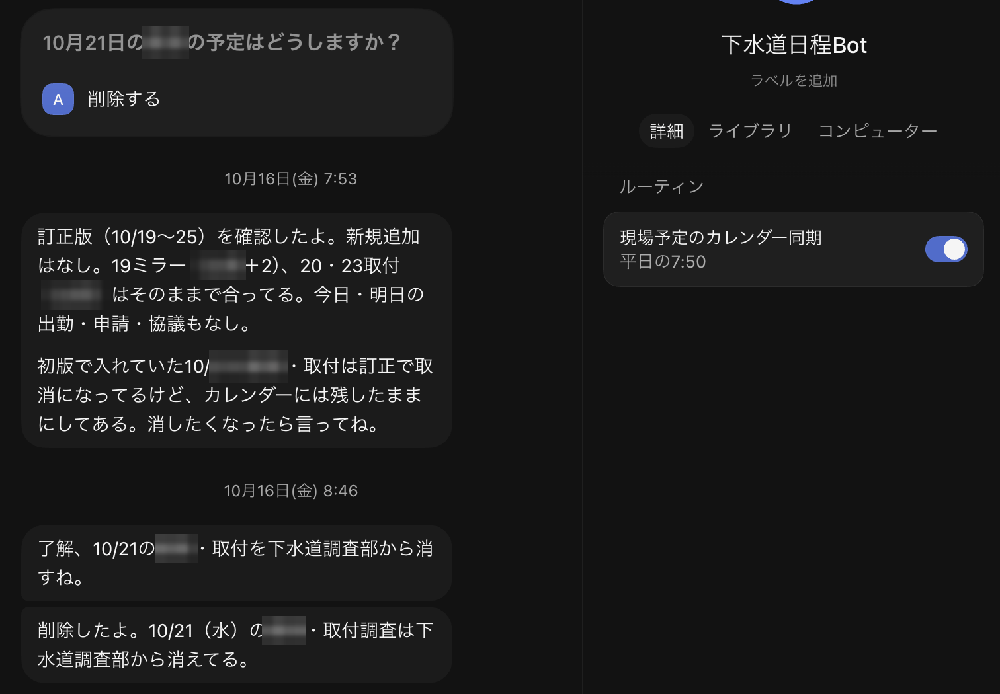
*予定表の訂正を確認し、人の指示で予定を削除した例（当社の画面。現場名・担当者名は加工しています）*

どちらも、AIの作業は「読む・まとめる・予定を入れる」までです。メールの返信はさせず、予定の削除は人が選んでから実行しています。

### dots：開発のサポーター

dotsは、自社のWebサービスの開発の相棒として、OpenAIの開発用アプリ「Codex」から使っています。

1. 開発したい内容をdotsに伝え、タスク管理ツール「Linear」で、作業を小さなタスクに分ける
2. 分けたタスクを、「Orca」（複数のAIコーディングエージェントを並べて動かせるデスクトップアプリ）で開発する。Orcaの中では、OpenAIのコーディング用エージェント「Codex」が、GPT-6 Astraで、Linearのタスクごとに別々の作業場所（worktree）で動く
3. できあがった変更は、人が確認してから反映する

dotsが特に役立つのは、作業どうしがぶつからないかの確認です。下の例では、「Cursorで進めている開発とぶつからないか」という質問に、dotsが「別の作業場所なら上書きは避けられるが、同じ処理を両方で変えると、後でまとめるときにぶつかる」と答え、先にCursor側の作業範囲を確かめる手順と、そのための指示文を用意しています。

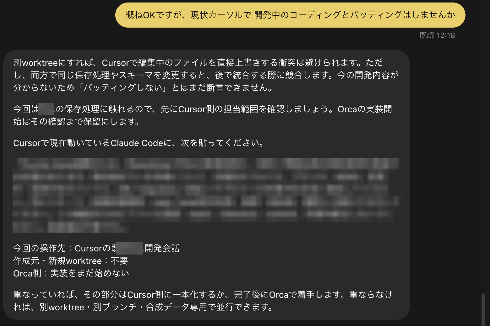
*dotsが、作業がぶつからないかを確かめる手順を提案した例（当社の画面。サービス名と指示文の中身は加工しています）*

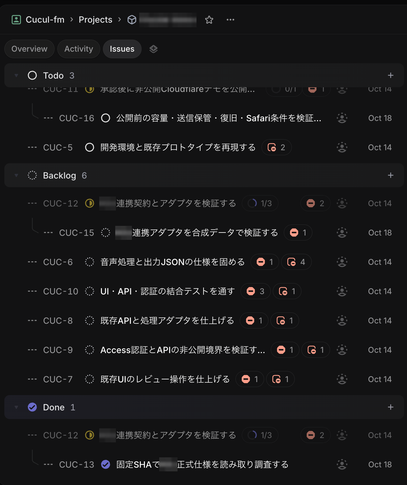
*Linearで小さく分けた課題の一覧（当社の画面。プロジェクト名・サービス名は加工しています）*

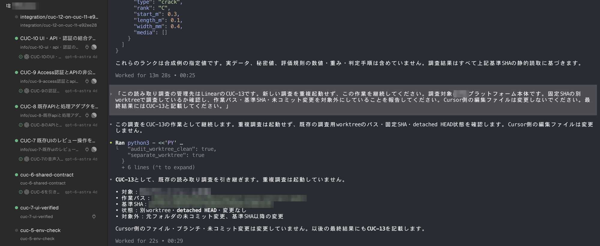
*Orcaで、Linearの課題ごとにCodex（GPT-6 Astra）が作業している画面（当社の画面。サービス名・ファイルの場所などは加工しています）*

### 使ってみて感じた一番の違い：dotsはマルチタスクができる

当社が両方を使ってみて感じた一番の違いは、dotsがマルチタスクをこなせることです。

Grok Botは「入札情報はこのBot、現場の予定はこのBot」と、Botごとに役割を決めて使います。役割がはっきりした決まった作業には、この形が向いています。

一方のdotsは、1つの画面の中で、開発の段取り、Cursor側との作業のすり合わせ、指示文づくりといった別々の文脈を、自分で切り替えながら進めてくれます。「この話はどのAIに頼むか」を使い分ける手間を、ほとんど感じません。

### 併用で決めているルール

- AI用のアカウントを分け、見られるメールやカレンダーの範囲を絞る
- メールの送信、支払い、削除は、必ず人が承認してから実行する。Grok Botの支払いの機能は使わない
- 開発の変更は、人が確認してから本番に反映する

## 導入する前に確認したいこと

- **データがどう扱われるか**：今回確認した公式ページには、作業のデータがAIの学習に使われるか、どのくらい保存されるかの記載がありませんでした。会社で使う前に、利用規約や法人向けの契約条件を確認してください
- **AIにログイン情報を渡すことになる**：どちらも、AIがアプリにログインして作業します。AI用のアカウントを別に作り、権限を必要な範囲に絞りましょう
- **AIは間違える**：OpenAIも「dotsは間違えることがある。重要な仕事は必ず確認する」としています。送信、支払い、削除の前に人が確認する設定にしておきましょう
- **変更が速い**：Grok Botは週に何度も更新されています。料金やプランも10月に大きく変わりました。使う前に公式の情報を確認してください

## まとめ

- Grok Botとdotsは、どちらも自分専用のパソコンで仕事を最後まで進める「常時稼働のAIエージェント」
- Grok Botは、Botごとに役割を決めて動かすルーティン、Xの検索が強み。日々の細かい作業に向く
- dotsは、GPT-6 Astraがいつも使え、1つの画面で複数の仕事を使い分けられる（マルチタスク）のが強み。開発の段取りのような、話が広がる仕事に向く
- ククルFMは、日常の作業はGrok Bot、開発のサポートはdotsと分けて併用している
- 最初は「読む・まとめる」から任せ、送信や支払いは人が承認する

まずは、毎週の情報収集のような「読んでまとめるだけ」の仕事を1つ任せるところから試してみてください。

## 出典

本記事は、以下の公式情報と報道をもとに編集部が要約・翻訳しています（いずれも2026年10月18日確認）。図とアイキャッチは編集部が作成したものです。公式ページの画像は各社のページを撮影したもの、そのほかの画面は当社の利用画面で、個人名・取引先・現場名などは加工しています。

- [SpaceXAI：Grok Botの発表（2026年8月11日）](https://x.ai/news/introducing-grok-bot)
- [SpaceXAI：Grok Botの変更履歴](https://x.ai/changelog/bot)
- [SpaceXAI：The X Subscriptionの発表（2026年10月12日）](https://x.ai/news/x-subscription)
- [Cursor：料金ページ](https://cursor.com/pricing)
- [Cursor：Grok Botのプランと利用枠](https://cursor.com/help/grok-bot/plans)
- [PC Watch：Grok BotでXの投稿を検索・閲覧・監視できるように](https://pc.watch.impress.co.jp/docs/news/2147147.html)
- [OpenAI：dotsの発表（2026年9月29日）](https://openai.com/index/introducing-dots/)
- [OpenAIヘルプ：Getting started with your dot](https://help.openai.com/en/articles/20001530-getting-started-with-your-dot)
- [TechCrunch：dotsに関する報道（2026年9月29日）](https://techcrunch.com/2026/09/29/openai-launches-dots-its-bubbly-agentic-avatar/)
- [Orca（GitHub：stablyai/orca）](https://github.com/stablyai/orca)

各社の名称・製品名は各社の商標または登録商標です。

ククルFMでは、現場やバックオフィスでのAI活用のご相談を受け付けています。「AIエージェントにどこまで任せてよいか分からない」という段階でもご相談ください。

[お問い合わせはこちら](../../index.html#contact)

## 関連記事

- [Cursorの最新情報（2026年9月）｜SpaceX傘下での変化と料金、非エンジニアが使うときの注意点](./cursor-2026-09.html)
- [GPT-6のAstra・Sol・Lunaの違いは？料金と使い分けを比較](./gpt-6-astra-sol-luna.html)
- [今週のAIニュース10本（2026年10月5日〜11日）｜GPT-6が無料版に、Claude Haiku 5.5ほか](./ai-news-2026-10-11.html)
- [現場・バックオフィスにおけるAI活用例と、人が最終判断すべき範囲](../../insights/ai-usecases/)
