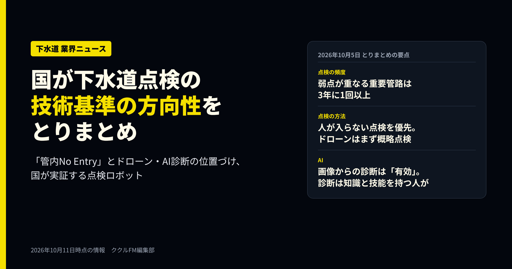
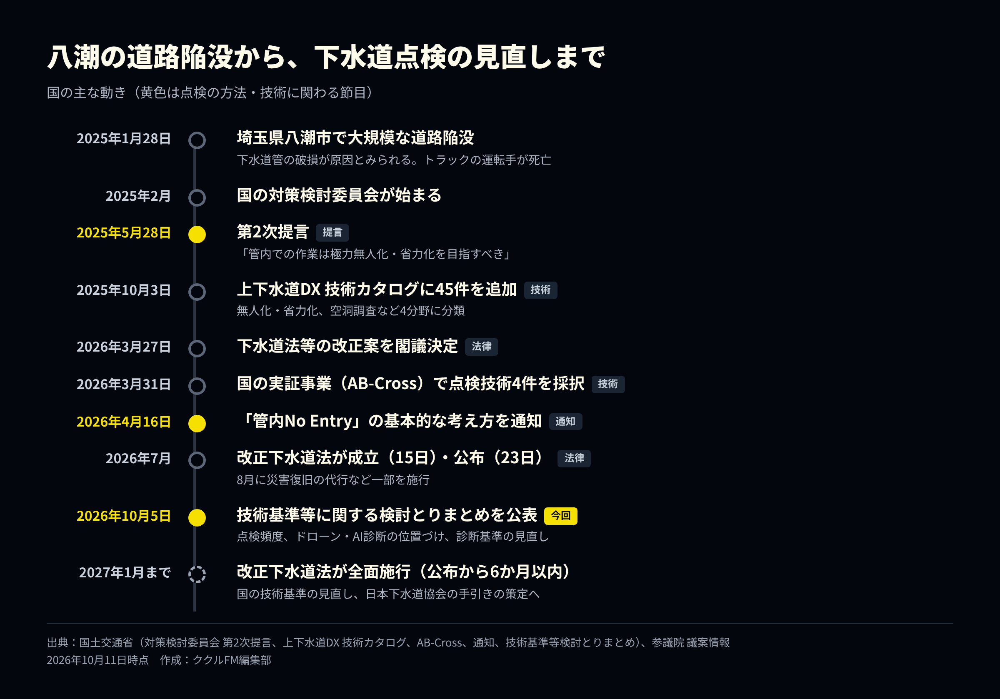

# 下水道点検、国が技術基準の方向性を公表｜「管内No Entry」とドローン・AI診断の位置づけ

**公開日**: 2026.10.11  
**カテゴリ**: 調査・清掃  
**著者**: ククルFM編集部  
**概要**: 国土交通省は2026年10月5日、下水道管路の技術基準に関する検討とりまとめを公表しました。点検頻度の考え方、管内に人が入らない点検、ドローンやAI診断の位置づけを整理し、国のカタログに載る技術と実証中のロボットを紹介します。

---

国土交通省は2026年10月5日、「下水道管路マネジメントのための技術基準等に関する検討とりまとめ」を公表しました。2025年1月に埼玉県八潮市で起きた道路陥没事故を受けて続いてきた議論の最終整理で、今後の国の技術基準の見直しのもとになります。

点検の頻度を管路の重要度と弱点に応じて決めること、人が管の中に入らない点検を優先すること、ドローンやAIによる診断をどう位置づけるかなどが示されました。この記事では、とりまとめの主な中身と、ここまでの経緯、国のカタログに載っている点検技術、2026年度に国が実証している技術を整理します。情報は2026年10月11日時点です。

※本記事はAI（Claude）の支援を受けて作成し、内容は編集部が国の公表資料と各社の発表で確認しています。

## とりまとめで示された主な内容

### 点検の頻度は「重要度」と「弱点」で決める

とりまとめでは、社会的な影響が大きい大口径の管路などを「重要管路」とし、それ以外の管路と分けて管理する考え方が示されました。重要管路の中でも、弱点の重なり方によって点検の頻度が変わります。

| 対象 | 点検の頻度 |
|---|---|
| 重要管路のうち、化学的・力学的・地盤的な弱点が重なる箇所や、硫化水素の濃度が特に高い箇所 | 3年に1回以上 |
| 重要管路のうち、いずれかの弱点がある箇所 | 5年に1回以上 |
| 重要管路のその他の箇所 | 10年に1回以上 |
| 重要管路以外の、化学的な弱点がある箇所 | 5年に1回以上 |
| 重要管路以外のその他の管路 | 自治体がリスクを評価して設定 |

直近の詳細点検で健全度Ⅲと判定された箇所は、これより頻度を上げ（例：3年に1回→1〜2年に1回）、あわせて空洞調査も行うとされています。

### 人が入らない点検を優先し、ドローンは「まず概略点検」

2026年4月16日、国は「管内No Entry」の実現に向けた点検の基本的な考え方を通知しています。とりまとめはこれを踏まえ、潜って目で見る点検によらない、安全で効率的な点検のために新技術の活用が有効だとしました。

ただし、飛行式ドローンや浮流式カメラは、いまの一般的な技術レベルでは「概略点検」に当たると整理されています。十分に見えていて健全度の区分ができる場合には、詳細点検として扱えるとも書かれました。カメラの性能、管内での位置の把握、曲がった区間の飛行などの精度を上げることが、今後の課題として挙げられています。

### AIによる診断は「有効」、診断は知識と技能を持つ人が

AIについては、画像認識や診断の技術で「異状を正確かつ迅速に検出して状態を診断することも有効」とされ、国がデータを集めて技術開発につなげる方針も示されました。一方で、診断は必要な知識と技能を持つ人が行うこととし、技術者の能力を高める取り組みも求めています。鉄筋コンクリート管の診断基準の見直しや、シールド管の診断基準の新設も盛り込まれました。

明確な診断が難しい箇所については、点検方法を高度化するなど複数の手法を試し、診断ができるまでは巡視や路面下の空洞調査で安全を確保するとしています。新しい技術を使っても判断がつかない場合は、改築や管路の複線化などの措置をとる考え方です。

### 点検以外の方針：複線化、マンホールの見直し、道路管理者との共有

点検と診断のほかにも、維持管理のしかたそのものを変える方針が並びました。重要管路のうち、水位を下げられず点検が難しい箇所では、管路を2本にする「複線化」などで多重化することを原則とします。改築の機会には、マンホールの間隔や構造を見直し、点検しやすい管路にしていくことも原則とされました。点検の結果を道路管理者と共有し、道路の安全確保に必要な措置を一緒に協議することも求めています。

## ここまでの経緯

*国の公表資料をもとに編集部で作成（2026年10月11日時点）*

事故の翌月に国の対策検討委員会が設けられ、2025年5月28日の第2次提言で「管内での作業は極力無人化・省力化を目指すべき」との方向が示されました。2026年に入ると法改正が進み、改正下水道法は7月15日に成立、7月23日に公布されています。腐食のおそれが大きい管路を5年に1回以上としていた点検の決まりに加えて、施設の安全性を判断する診断の基準も法律上の基準に含める内容です。8月には災害復旧の代行など一部の規定が施行され、残りは公布から6か月以内、遅くとも2027年1月までに施行されます。

技術の面では、2025年10月に国の「上下水道DX 技術カタログ」が拡充され、2026年3月には国の実証事業で点検ロボットやドローンの実証が採択されました。4月の「管内No Entry」通知で、人が入らない点検を優先する考え方がはっきりと示され、10月のとりまとめで、その中での新技術の位置づけが整理された形です。

## 国のカタログに載る「人が入らない調査」の技術

国交省の「上下水道DX 技術カタログ」は、2025年10月3日に45件の技術を追加し、提言の対象分野に当たる技術を「管路内調査の無人化・省力化」「大深度の空洞調査」「大口径管の管厚・強度測定」「センシングによる継続的なモニタリング」の4分野に分けて示しました。無人化・省力化の分野に載る主な技術は次のとおりです。

| 技術 | 保有者 | 内容 | カタログ上の導入実績 |
|---|---|---|---|
| 超狭小空間点検ドローン「IBIS2」 | Liberaware | GPSの届かない暗い管内でも安定して飛ぶ小型ドローン | 約30件（千葉県、北九州市、神戸市など） |
| 大口径管きょスクリーニング用カメラ「KPRO-Ftype」 | 管清工業 | 船型の本体を流れに乗せて撮影し、録画を後で判定 | 約30事業者 |
| 浮流式点検システム「フロート」・報告書システム「INSSEP」 | カンツール | 口径800mm以上の管を流下しながら撮影し、動画から報告書を作成 | 7社（自治体の維持管理の委託先） |
| 閉鎖性空間点検ドローン（水上走行式・飛行式） | NJS、ACSL | 水上を一定速度で走る、または管内を飛んで、供用中の中・大口径管を撮影 | 須崎市で累計約58,857m（水上）、約19,143m（飛行） |
| 球体ドローン「ELIOS 3」による点検 | ブルーイノベーション | 球体のガードを付けたドローンを地上から操縦 | 3事業者（静岡市、東京都下水道局など） |
| 下水管渠調査効率化ソフトウェア「スマカン」 | ジャスト | カメラの展開画像をAIで判定し、報告書を作成 | 4事業者（主に民間の委託先） |
| AI画像認識による管路損傷の自動検出 | 福山コンサルタント、日本下水道新技術機構 | 物体検出と領域の切り分けで、さまざまな損傷を検出 | 1事業者 |

大きく分けると、管の中を飛ぶドローン、流れに乗せて撮るカメラ、水面を走るドローンといった「撮り方」を変える技術と、撮った映像の判定や報告書づくりをAIで助ける「後工程」の技術があります。とりまとめの整理に当てはめると、撮り方を変える技術は、まず概略点検として広い範囲を短時間で確かめる役割が中心になります。なお、表の導入実績はカタログの記載どおりで、数え方は技術ごとに違い、自治体などの発注者の数を数えているものもあります。

AIの判定ソフトでは、ジャストの「スマカン」をめぐり、2026年8月に奥村組、ヤマソウ、横浜市下水道管理協同組合、ジャストが、福島県いわき市で管路の洗浄から点検・診断までを一続きで行う手法の実証を発表しました。AIが損傷の候補を抜き出す機能について、今後も精度の改良と検証を進めるとしています。

## 2026年度に国が実証する技術

国交省は2026年3月31日、上下水道の革新的な技術を実証する「AB-Crossプロジェクト」の2026年度の採択を発表しました。下水道管路の点検に関わるものは次の4件です。

| 実証事業 | 実施者 | 内容 |
|---|---|---|
| No Entry実現に向けた概略点検・詳細点検併用型ドローン×AI実証事業 | Liberaware、管清工業、日水コン、アキュイティー、千葉市 | IBIS2をもとに、概略点検と詳細点検を組み合わせ、AIで解析する |
| 下水道管路におけるフロート式点検ロボットの実証事業 | 日本工営、ウオールナット、埼玉県 | 通水したまま浮かべて流し、電磁波レーダーで管の厚さと背面の空洞を連続して測る。埼玉県の新河岸川幹線で実証 |
| 予防保全を実現する下水道次世代DXモデル実証事業 | 埼玉県、NTT東日本、NTTeDroneTechnology、ジャパン・インフラ・ウェイマーク、NTTインフラネット、国際航業、埼玉県土木施設維持管理協会 | 飛行式ドローンと浮流式カメラで点検し、AIと3D点群で損傷を検出、デジタル台帳で管理する。埼玉県の流域下水道で実証 |
| 天井走行ロボットを用いた下水道管路背面の初期空洞に対する無人点検技術の実証 | 前田建設工業、三井住友建設、東京大学 | 口径1,500mm以上の管の天井を走り、電磁波レーダーや打音などを組み合わせて背面の空洞を探す。熊本県北部流域下水道で実証 |

4件のうち2件は、管の内側の状態だけでなく、管の外側（背面）にできた空洞を探すことを目的にしています。とりまとめで健全度Ⅲの箇所に空洞調査が求められたこともあり、管の中から背面の空洞を確かめる技術が実用になるかどうかは、今後の点検の進め方に関わる点です。

このほか、国の実証事業とは別に、テムザックが2025年1月、16本の脚で口径200mm以上の管を歩いて点検・補修を行う多脚ロボット「SPD-X」の開発を発表しています。

## 今後の予定

今後は、とりまとめを踏まえて国の技術基準が見直され、公益社団法人日本下水道協会が運用を支える手引きをつくる予定です。改正下水道法は、遅くとも2027年1月までに全面的に施行されます。

点検の回数が増える一方で、管内に人が入る作業は減らす。この2つをどう両立させるかが、これからの下水道の維持管理の課題になります。ドローンや浮流式カメラがどこまで詳細点検として認められるか、AIの診断がどこまで実務に入るか、空洞を探すロボットの実証がどんな結果を出すか。技術基準の改定と2026年度の実証の結果が、次の注目点です。

## 出典

本記事は、以下の公表資料と発表をもとに編集部が要約しています（いずれも2026年10月11日確認）。図とアイキャッチは編集部が作成したもので、各社の画像は使用していません。

- [国土交通省：下水道管路マネジメントのための技術基準等に関する検討とりまとめ（2026年10月5日）](https://www.mlit.go.jp/mizukokudo/sewerage/content/002025776.pdf)
- [国土交通省：同 概要（2026年10月5日）](https://www.mlit.go.jp/mizukokudo/sewerage/content/002025682.pdf)
- [国土交通省：令和8年度 通知・事務連絡（「管内No Entry」通知、改正法の施行など）](https://www.mlit.go.jp/mizukokudo/sewerage/mizukokudo_sewerage_tk_001114.html)
- [国土交通省：下水道等に起因する大規模な道路陥没事故を踏まえた対策検討委員会 第2次提言（2025年5月28日）](https://www.mlit.go.jp/mizukokudo/sewerage/content/001891084.pdf)
- [参議院：下水道法等の一部を改正する法律案（議案の経過）](https://www.sangiin.go.jp/japanese/joho1/kousei/gian/221/meisai/m221080221038.htm)
- [国土交通省：上下水道DX 技術カタログを拡充します（2025年10月3日）](https://www.mlit.go.jp/report/press/mizukokudo13_hh_000680.html)
- [国土交通省：同 別紙2（提言の対象分野による分類）](https://www.mlit.go.jp/report/press/content/001913786.pdf)
- [国土交通省：AB-Crossプロジェクト 2026年度の採択（2026年3月31日）](https://www.mlit.go.jp/report/press/mizukokudo13_hh_000726.html)
- [国土交通省：令和8年度 上下水道一体革新的技術実証事業等 実施一覧](https://www.mlit.go.jp/mizukokudo/sewerage/content/002010796.pdf)
- [国土交通省：AB-Cross 各実証の概要](https://www.mlit.go.jp/mizukokudo/sewerage/mizukokudo_sewerage_tk_001076.html)
- [奥村組：下水道管路の調査を効率化する新たな手法を実証（2026年8月4日）](https://www.okumuragumi.co.jp/newsrelease/2026/post-77.html)
- [テムザック：多脚式ロボット「SPD-X」を開発（2025年1月17日）](https://www.tmsuk.co.jp/topics/6581/)

各社の名称・製品名は各社の商標または登録商標です。

## 関連

- [下水道カメラ調査の方式：ミラー・TV・取付管・押し込み](./sewer-camera-methods.html)
- [管路の損傷判定の見方：報告書の記号と写真](./sewer-damage-report.html)
- [マンホール作業の安全：酸欠・硫化水素と交通誘導](./manhole-safety.html)
